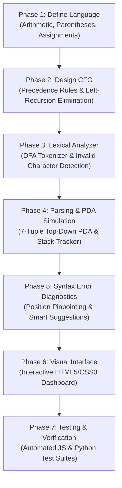

# CFG & Pushdown Automaton (PDA) Syntax Analyzer & Visualizer
**Course:** Theory of Computation & Formal Automata (TOC/FA)  
**Project Prototype & Reference Implementation**

---

## 1. What Exactly Does This Project Do?

This project is an **interactive visual syntax analyzer and formal automaton simulator**. It bridges the theoretical concepts of **Context-Free Grammars (CFG)** and **Pushdown Automata (PDA)** with practical compiler front-end techniques (lexical analysis, predictive parsing, stack-based automata execution, syntax error diagnosis, and concrete syntax tree generation).

### Key Input and Output Behavior

#### Valid Input Example
- **Input:** `a + b * c`
- **Output:**
  - **Lexical Stream:** `IDENTIFIER('a')`, `PLUS('+')`, `IDENTIFIER('b')`, `STAR('*')`, `IDENTIFIER('c')`
  - **Syntax Verdict:** ✅ **Syntax is valid! Accepted by PDA.**
  - **PDA Simulation:** Transitioned from state $q_{start} \to q_{loop} \to q_{accept}$ across 17 steps. The stack held non-terminals, expanded rules according to operator precedence (`*` before `+`), matched all terminals, and successfully reached an empty stack / $Z_0$ marker upon encountering EOF (`$`).
  - **Derivation & Parse Tree:** Generates the hierarchical concrete syntax tree showing $E$ deriving terms and factors.

#### Invalid Input Example (Consecutive Operators)
- **Input:** `a + * b`
- **Output:**
  - **Syntax Verdict:** ❌ **Syntax is invalid! Rejected by PDA.**
  - **Error Type:** `Consecutive Operators`
  - **Position:** Column 5
  - **Diagnostic Message:** `Unexpected operator '*' immediately after '+'.`
  - **Correction Suggestion:** `Remove '*' or insert an operand between '+' and '*'.`
  - **PDA State:** Trapped into state $q_{error}$ at step 7 when top of stack was expecting a factor/term, but lookahead was `*`.

#### Invalid Input Example (Unmatched Parentheses)
- **Input:** `a + (b * c`
- **Output:**
  - **Syntax Verdict:** ❌ **Syntax is invalid! Rejected by PDA.**
  - **Error Type:** `Unmatched Parenthesis`
  - **Position:** Column 10 (End of File)
  - **Diagnostic Message:** `Missing closing parenthesis ')' before '$'.`
  - **Correction Suggestion:** `Insert a ')' to close the open sub-expression opened at column 5.`

---

### CFG vs. PDA: Theoretical Demonstration

| Dimension | Context-Free Grammar (CFG) | Pushdown Automaton (PDA) |
| :--- | :--- | :--- |
| **Role** | Declarative specification of syntax rules and hierarchical structure. | Operational machine executing transitions over an input tape with stack storage. |
| **Formalism** | $G = (V, \Sigma, R, S)$ | $M = (Q, \Sigma, \Gamma, \delta, q_0, Z_0, F)$ |
| **Handling Precedence** | Stratified into levels: $E$ (additive), $T$ (multiplicative), $F$ (primary/parenthesized). | Stack stores intermediate operations and defers additive operations until multiplicative terms are reduced. |
| **Stack Mechanics** | Explains derivations ($S \Rightarrow \alpha \Rightarrow \dots$). | Executes explicit push, pop, match, and epsilon reductions. |

> **Crucial Distinction:** Simply counting matching opening and closing brackets is **not** sufficient for a PDA. A counter only recognizes simple languages like $L = \{a^n b^n\}$. An arithmetic PDA must simultaneously enforce:
> 1. Correct operator placement (no `+ *`),
> 2. Valid operand positioning,
> 3. Operator precedence (`*` binds tighter than `+`),
> 4. Nested matching of parenthesized sub-expressions,
> 5. Assignment structure (`id = E`).

---

## 2. Formal Definition of the Pushdown Automaton

The simulator implements a deterministic Top-Down Predictive Pushdown Automaton:
$$M = (Q, \Sigma, \Gamma, \delta, q_0, Z_0, F)$$

Where:
- **States ($Q$):** $\{ q_{start}, q_{loop}, q_{accept}, q_{error} \}$
- **Input Alphabet ($\Sigma$):** $\{ \text{id}, \text{num}, =, +, -, *, /, \%, \text{\textasciicircum}, (, ), \$ \}$
- **Stack Alphabet ($\Gamma$):** $\{ Z_0, S, S', E, E', T, T', F, \text{id}, \text{num}, =, +, -, *, /, \%, (, ) \}$
- **Start State ($q_0$):** $q_{start}$
- **Initial Stack Symbol ($Z_0$):** $Z_0$ (Bottom-of-stack marker)
- **Accepting States ($F$):** $\{ q_{accept} \}$ (Acceptance by final state and empty stack)

### Transition Function Rules ($\delta$):
1. **Initialization:**
   $$\delta(q_{start}, \epsilon, Z_0) = (q_{loop}, S Z_0)$$
2. **Rule Expansion (Non-Terminal on Stack Top):**
   $$\delta(q_{loop}, \epsilon, A) = (q_{loop}, \alpha^R)$$
   *(where $A \to \alpha$ is looked up in LL(1) parsing table $M[A, a]$ for lookahead $a$, and $\alpha^R$ denotes pushing RHS symbols in reverse order so the leftmost symbol is at the top of the stack).*
3. **Terminal Match (Terminal on Stack Top matching Input Token):**
   $$\delta(q_{loop}, a, a) = (q_{loop}, \epsilon)$$
   *(consumes terminal $a$ from input and pops $a$ from stack).*
4. **Acceptance:**
   $$\delta(q_{loop}, \$, Z_0) = (q_{accept}, \epsilon)$$
5. **Trap / Error:**
   If $M[A, a]$ is undefined or top terminal does not match lookahead:
   $$\delta(q_{loop}, a, X) = (q_{error}, X)$$

---

## 3. Project Roadmap (Phases 1 to 7)



### Phase 1 — Define the Language
Supported constructs:
- Identifiers: `[a-zA-Z_][a-zA-Z0-9_]*` (e.g. `a`, `foo_bar`, `count1`)
- Numeric literals: Integers and floating-point values (e.g. `42`, `3.14`)
- Arithmetic operators: `+`, `-`, `*`, `/`, `%`, `^`
- Assignment: `id = E`
- Nested expressions: `( ... )`

### Phase 2 — Design the CFG
#### Natural Grammar (Precedence & Associativity):
```text
S -> id = E | E
E -> E + T | E - T | T
T -> T * F | T / F | T % F | F
F -> ( E ) | id | num
```

#### Transformed LL(1) Grammar (Left-Recursion Eliminated):
```text
1.  S  -> id S'
2.  S  -> num T' E'
3.  S  -> ( E ) T' E'
4.  S' -> = E
5.  S' -> T' E'
6.  E  -> T E'
7.  E' -> + T E'
8.  E' -> - T E'
9.  E' -> ε
10. T  -> F T'
11. T' -> * F T'
12. T' -> / F T'
13. T' -> % F T'
14. T' -> ε
15. F  -> ( E )
16. F  -> id
17. F  -> num
```

### Phase 3 — Build the Lexical Analyzer
Implemented in both `js/lexer.js` and `python/lexer.py`.
- Recognizes all tokens.
- Reports exact 1-based line and column offsets.
- Flags lexical errors (e.g. `@`, `#`, malformed numbers like `123abc`).

### Phase 4 — Implement Parsing and PDA Simulation
Implemented in `js/pda.js` and `python/pda.py`.
- Step-by-step transition recorder storing:
  `stepNumber`, `state`, `stack`, `readHead`, `currentToken`, `action`, `rule`, `description`.
- Supports Play/Pause, Step Next, Step Prev, Reset, and Jump to End.

### Phase 5 — Detect and Explain Syntax Errors
Catches and diagnoses:
- Missing opening/closing parentheses
- Consecutive operators (`a + * b`)
- Trailing operators (`a + b +`)
- Missing operators between operands (`a b`)
- Incomplete assignments (`x =`)
- Unexpected end of expression

### Phase 6 — Develop the Interface
Modern web dashboard (`index.html`, `css/styles.css`, `js/ui.js`):
- Code Editor with instant token badges
- Vertical visual stack with push/pop animations
- Animated tape cells with active read-head
- Interactive SVG Parse Tree renderer
- Test Suite runner & Session History drawer

### Phase 7 — Test and Demonstrate
- 15 automated test cases executed across both JS and Python test runners with a 100% pass rate.

---

## 4. Module Implementation Architecture

The project is divided into six modular units:

```text
TOC_FA/
├── index.html              # Main interactive GUI application
├── css/
│   └── styles.css          # Responsive dark/light theme styling & animations
├── js/
│   ├── lexer.js            # Module 1: Tokenizer & Position Tracker
│   ├── grammar.js          # Module 2: CFG Engine & LL(1) Table Generator
│   ├── parsetree.js        # Module 2 & 5: Concrete Syntax Tree & SVG Builder
│   ├── pda.js              # Module 3 & 4: Formal PDA Simulator & Error Diagnostics
│   └── ui.js               # Module 5 & 6: Interactive Controller & Player
├── python/
│   ├── lexer.py            # Python Lexer module
│   ├── cfg.py              # Python CFG & LL(1) module
│   ├── pda.py              # Python PDA Simulator module
│   ├── main.py             # Python CLI Driver
│   └── test_suite.py       # Python Automated Test Suite
├── tests/
│   └── test_engine.js      # Node.js Unit Test Runner
└── README.md               # Complete Project Documentation & Report
```

---

## 5. How to Run and Test

### Option A: Interactive Web Application (Recommended for Demos)
You can view the interface immediately:
1. Double-click [index.html](file:///c:/Users/AKANKSHA/OneDrive/Desktop/TOC_FA/index.html) to open it in any web browser.
2. Or serve it via Python:
   ```powershell
   python -m http.server 8000
   ```
   and navigate to `http://localhost:8000`.

### Option B: Python Command-Line Interface
Run any expression directly from the command line:
```powershell
# Valid expression
python python/main.py "a + b * c"

# Parenthesized assignment
python python/main.py "x = (a + 10) * 2"

# Invalid expression with error diagnostics
python python/main.py "a + * b"
```

### Option C: Run Automated Test Suites
Run the automated test suites to verify all 15 test cases:

```powershell
# Run JavaScript test suite via Node.js
node tests/test_engine.js

# Run Python test suite
python python/test_suite.py
```
